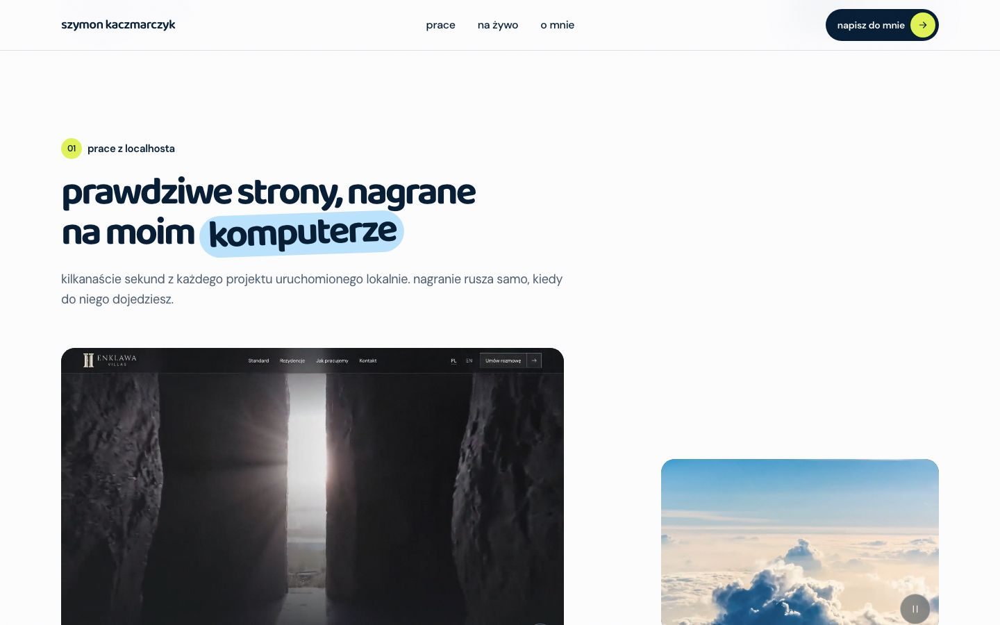
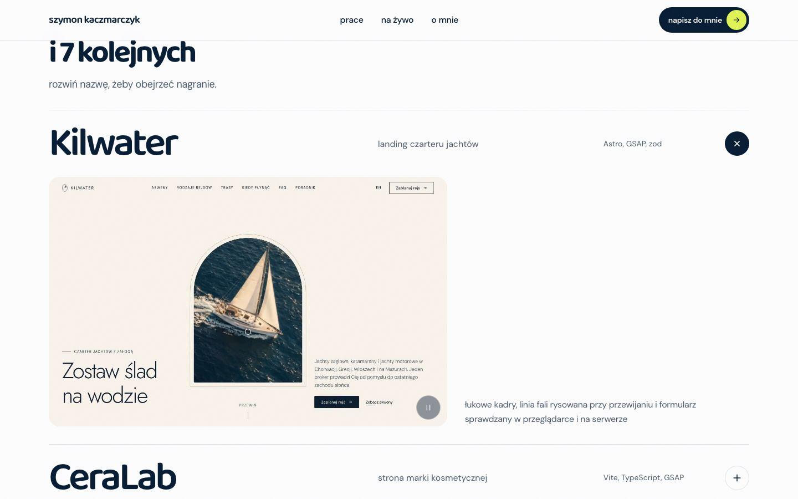
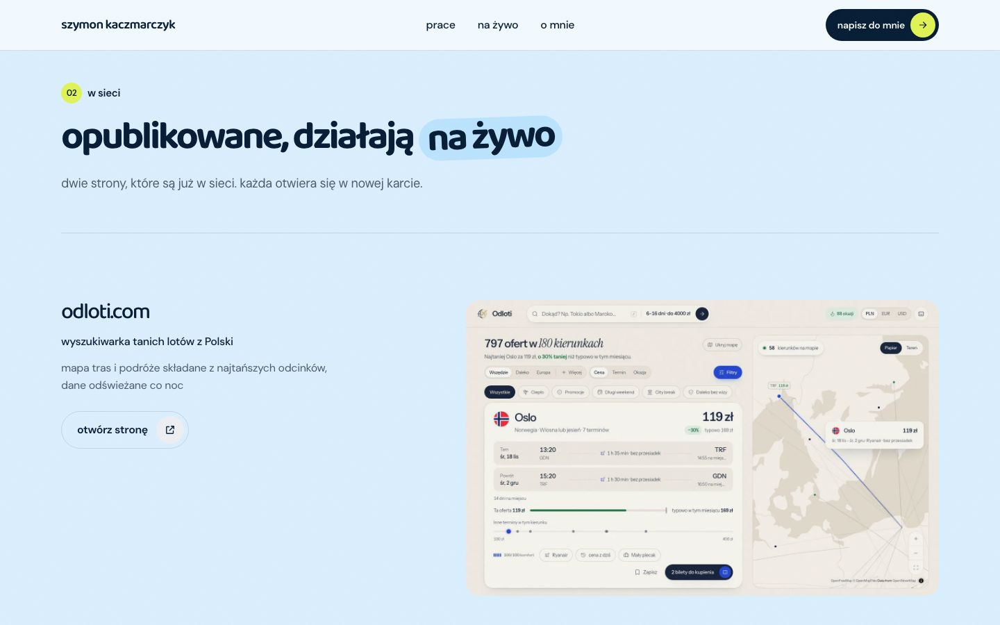

# Szymon Kaczmarczyk - portfolio

> Strony i aplikacje, które się ruszają.

Moje portfolio jako programisty. Zamiast statycznych zrzutów pokazuje nagrania prawdziwych projektów
uruchomionych lokalnie: kilkanaście sekund z każdej strony, z przewijaniem, kliknięciami i animacjami.
Obok nagrań są dwie strony, które już działają w sieci, krótko o mnie i kontakt.

Strona jest w pełni statyczna. Next.js 16 buduje ją do zwykłych plików HTML, CSS i JS, a GitHub Actions
publikuje je na GitHub Pages. Nie ma serwera, bazy danych, formularzy, cookies ani analityki.


## Dla kogo

- **Dla osób, które chcą zobaczyć, jak pracuję**, zanim napiszą. Nagrania pokazują, jak strona zachowuje się
  w ruchu, a nie tylko jak wygląda na jednym kadrze.
- **Dla programistów**, którzy szukają przykładu statycznego portfolio w Next.js z cięższym ruchem
  (WebGL, GSAP, Lenis), które dalej trzyma wysokie wyniki Lighthouse.

Nie jest to sklep ani strona firmy. Portfolio nie sprzedaje usług przez internet i nie zbiera danych.

## Jak to działa

```
src/ (Next.js, App Router) ──► next build ──► out/ (statyczne pliki)
        │                                        │
        │                                        └──► GitHub Actions ──► GitHub Pages
        │
        ├── data/prace.ts      lista nagranych prac i stron na żywo
        ├── data/strona.ts     adres strony, imię, e-mail, GitHub
        └── public/            nagrania, plakaty, zrzuty, zdjęcie, fonty
```

**Treści** są w dwóch plikach z danymi. Dodanie pracy to nowy wpis w `src/data/prace.ts` i pliki
`<slug>.mp4`, `<slug>.webm`, `<slug>.jpg` oraz `<slug>-720.webp` / `<slug>-1440.webp` w `public/prace/`.

**Nagrania** powstają poza tym repo, w osobnych lokalnych narzędziach. Skrypt Playwright przewija każdą
stronę w stałym tempie, a ffmpeg tnie i kompresuje wideo do mp4 i webm poniżej 3 MB. Do repo trafiają tylko
gotowe pliki.

**Wideo na stronie** wczytuje się dopiero wtedy, gdy kadr jest widoczny i strona skończyła się ładować.
Gra tylko w kadrze, pauzuje poza nim, a przy `prefers-reduced-motion` i trybie oszczędzania danych zostaje
plakat.

**Ruch** obsługuje jedna biblioteka, GSAP z ScrollTrigger, a na urządzeniach z myszą także płynne przewijanie
Lenis. Ciekłe tło w hero to własny shader WebGL (metaballe z gładką sumą SDF), ładowany dopiero po wejściu
strony i zatrzymywany poza ekranem.

## Funkcje

| Adres | Co to jest |
|---|---|
| `/` | Hero z ciekłym tłem, showreel rosnący do pełnej szerokości, prace, strony na żywo, o mnie, kontakt |
| `/polityka-prywatnosci/` | Polityka prywatności zgodna z RODO |
| `/regulamin/` | Regulamin, w tym zakres licencji MIT |
| każdy inny adres | Własna strona 404 w stylu reszty strony |

Na stronie głównej:

- **Prace z localhosta** - cztery wyróżnione nagrania w asymetrycznej siatce, które grają same w kadrze.
- **Indeks kolejnych prac** - nazwy w wierszach, podgląd wideo przy kursorze i rozwijane nagranie po kliknięciu.
- **Na żywo** - dwie opublikowane strony ze zrzutem i linkiem otwieranym w nowej karcie.
- **O mnie** - zdjęcie, krótki opis, obszary pracy i narzędzia na co dzień.
- **Kontakt** - e-mail i GitHub.

## Zrzuty ekranu

| Prace z localhosta | Indeks z rozwiniętym nagraniem |
|---|---|
|  |  |

| Strony na żywo | O mnie |
|---|---|
|  |  |

| Kontakt | Strona 404 |
|---|---|
|  |  |

| Telefon |
|---|
|  |

Zrzuty pokazują stronę w obecnej wersji. Nie ma na niej danych osobowych poza moim imieniem, zdjęciem
i adresem e-mail, które są publiczne z założenia.

## Uruchomienie

Wymagany Node.js 20.9 lub nowszy (GitHub Actions używa Node 24).

```bash
npm install
npm run dev        # http://localhost:4800
```

| Skrypt | Co robi |
|---|---|
| `npm run dev` | Serwer deweloperski na porcie 4800 |
| `npm run build` | Statyczny build do `out/` |
| `npm run preview` | Podgląd gotowego `out/` na http://127.0.0.1:4801, z obsługą zakresów dla wideo i stroną 404 |
| `npm run typecheck` | Sprawdzenie typów TypeScript |
| `npm run check:embed` | Sprawdza, czy strony z sekcji „na żywo” pozwalają się osadzić, i porównuje to z `src/data/prace.ts` |

## Konfiguracja

Projekt nie ma zmiennych środowiskowych ani sekretów. Wszystko, co zależy od miejsca publikacji, jest
w `src/data/strona.ts`:

| Pole | Opis |
|---|---|
| `siteUrl` | Pełny adres strony. Z niego biorą się canonical, Open Graph, `robots.txt` i `sitemap.xml`. |
| `owner.name`, `owner.email`, `owner.github` | Dane w kontakcie, stopce i dokumentach prawnych |

## Wdrożenie

Każdy push na gałąź `main` uruchamia `.github/workflows/deploy.yml`: `npm ci`, `npm run build`
i publikację katalogu `out/` na GitHub Pages. W ustawieniach repo **Settings → Pages → Source** musi być
ustawione na **GitHub Actions**.

Własna domena (np. subdomena is-a.dev): rekord CNAME na `szymonkaczmarczyk.github.io`, potem domena
w **Settings → Pages → Custom domain**, **Enforce HTTPS** i zmiana `siteUrl` w `src/data/strona.ts`.

## Struktura

```
src/
  app/                 strony (główna, polityka prywatności, regulamin, 404), robots.ts, sitemap.ts, style globalne
  components/          sekcje i elementy strony, każdy z własnym modułem CSS
  data/                prace.ts (nagrania i strony na żywo), strona.ts (adres i dane właściciela)
  lib/                 liquidRenderer.ts i liquidScene.ts (shader i fizyka cieczy), media.ts
public/
  prace/               nagrania prac: mp4, webm, plakat jpg i webp w dwóch szerokościach
  showreel/            montaż nagrań do hero
  live/                zrzuty stron na żywo
  o-mnie/              zdjęcie
  fonts/               Baloo 2 i DM Sans (woff2) z licencjami
scripts/               podgląd builda i sprawdzanie osadzania
docs/screenshots/      zrzuty używane w tym README
.github/workflows/     wdrożenie na GitHub Pages
```

## Bezpieczeństwo i prywatność

- Brak backendu, logowania, formularzy i bazy danych, więc nie ma czego przejąć po stronie serwera.
- Brak cookies, analityki i zewnętrznych zasobów: fonty, nagrania i zdjęcia są hostowane razem ze stroną.
- Linki zewnętrzne mają `rel="noopener noreferrer"`.
- GitHub Pages nie pozwala ustawić własnych nagłówków HTTP (CSP, `frame-ancestors`). Przy przeniesieniu
  na hosting z nagłówkami warto je dodać.

## Wydajność i dostępność

Pomiar Lighthouse na buildzie produkcyjnym: mobile 100/100/100/100, desktop 98/100/100/100, CLS 0.

- Fonty lokalnie w woff2 z podziałem na zakresy znaków, oba kroje ładowane z wyprzedzeniem.
- Plakaty w webp w dwóch szerokościach przez `srcset`, wideo w webm i mp4, wczytywane dopiero w kadrze.
- Shader cieczy startuje po załadowaniu strony, trzyma 60 klatek na komputerze i pauzuje poza ekranem.
- `prefers-reduced-motion` wyłącza ciecz, płynne przewijanie i autoodtwarzanie wideo.
- Obsługa klawiatury z widocznym focusem, link „przejdź do treści”, opisy alternatywne po polsku.

## Licencja

Kod źródłowy jest na licencji MIT, zobacz [`LICENSE`](LICENSE). Copyright (c) 2026 Szymon Kaczmarczyk.

Licencja nie obejmuje treści: nagrań, plakatów, zrzutów, zdjęcia i tekstów. Należą do autora i ich kopiowanie
poza dozwolony użytek wymaga zgody. Fonty Baloo 2 i DM Sans są na licencji SIL Open Font License 1.1,
a pliki licencji leżą obok fontów w `public/fonts/`.
