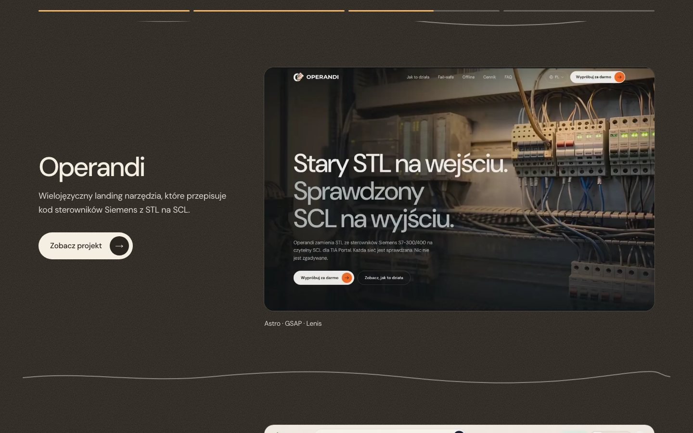
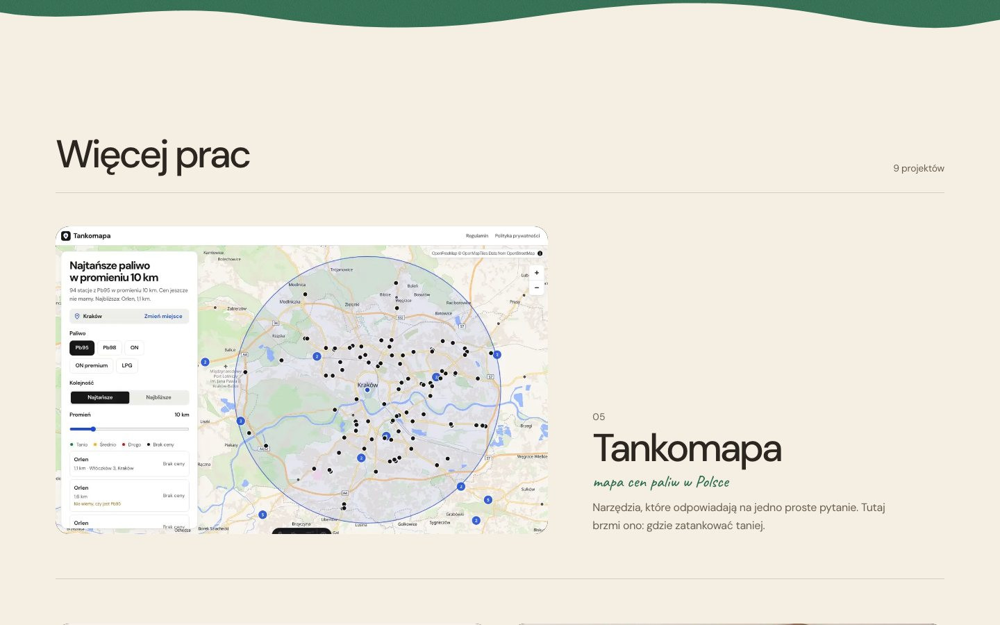
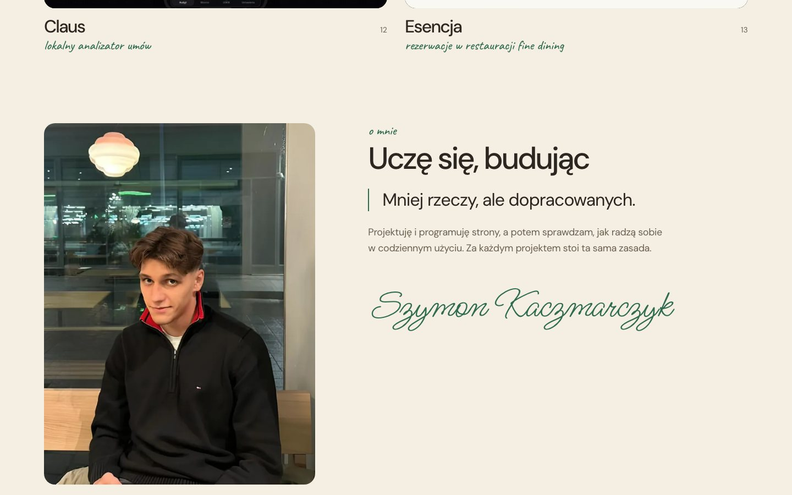
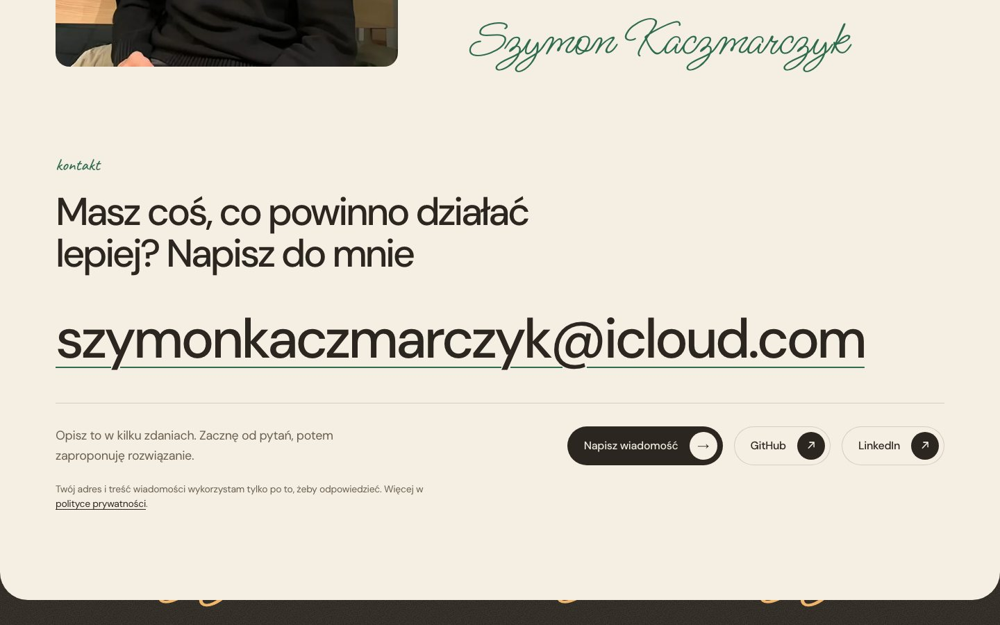
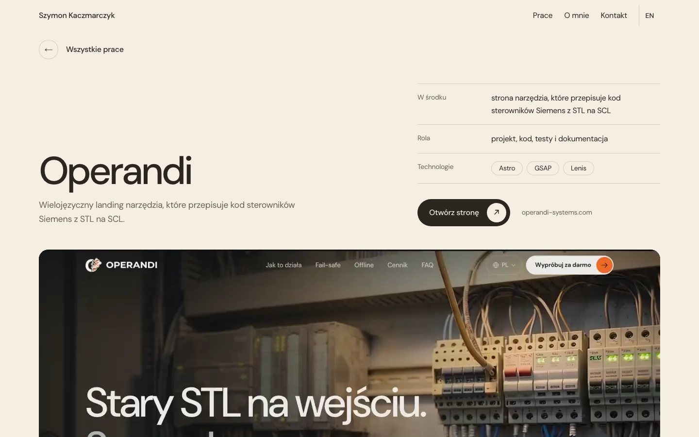
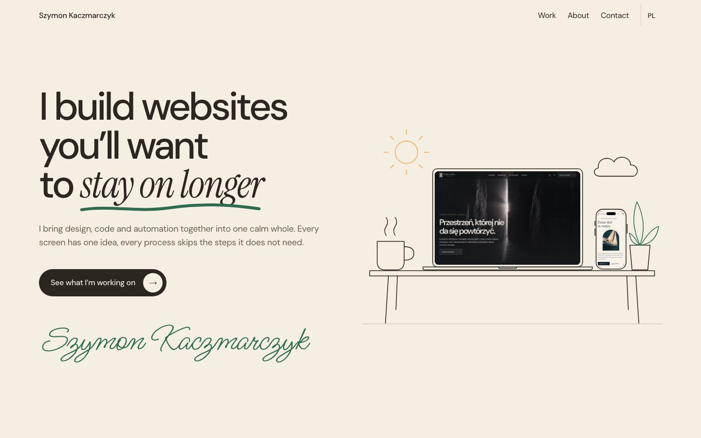
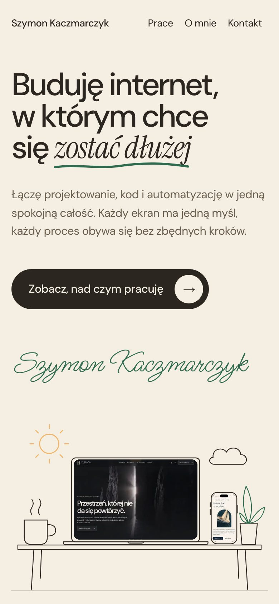
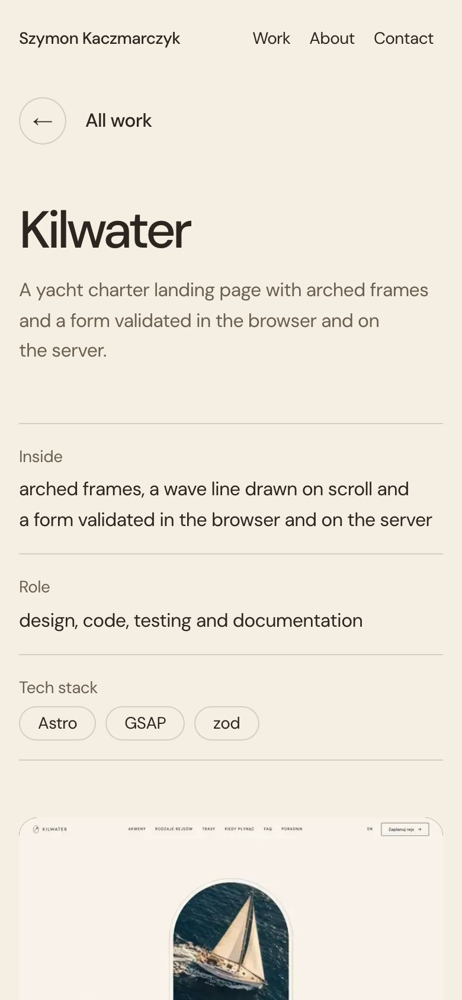
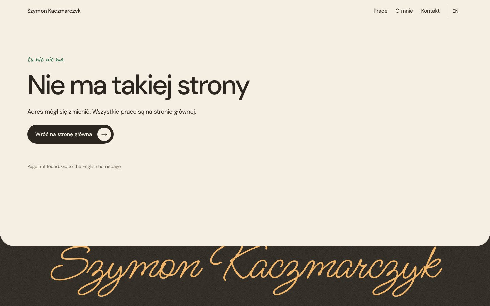

# Szymon Kaczmarczyk - portfolio

> Strony i narzędzia, które sam projektuję i piszę, od pierwszego szkicu do działającej wersji.

Na żywo: **[szymonkaczmarczyk.is-a.dev](https://szymonkaczmarczyk.is-a.dev)** (wersja angielska pod
[`/en/`](https://szymonkaczmarczyk.is-a.dev/en/)).

Moje portfolio. Zamiast statycznych zrzutów pokazuje nagrania 13 prawdziwych projektów: każda strona
przewija się od góry do dołu w płynnym nagraniu, a każdy projekt ma własną podstronę z opisem, rolą
i technologiami. Do tego krótko o mnie i kontakt, po polsku i po angielsku.

Strona jest w pełni statyczna. Astro buduje ją do zwykłych plików HTML i CSS z odrobiną JS, a GitHub
Actions publikuje je na GitHub Pages. Nie ma serwera, bazy danych, formularzy, cookies ani analityki.


## Dla kogo

- **Dla osób, które chcą zobaczyć, jak pracuję**, zanim napiszą. Nagrania pokazują, jak strona zachowuje się
  w ruchu, a nie tylko jak wygląda na jednym kadrze.
- **Dla rekruterów spoza Polski** - cała strona, z opisami projektów i dokumentami prawnymi, ma wersję angielską.
- **Dla programistów**, którzy szukają przykładu lekkiego portfolio w Astro: wideo w 120 kl./s, przejścia
  między stronami i animacje przy przewijaniu w samym CSS, a mimo to Lighthouse 100 na każdej stronie.

Nie jest to sklep ani strona firmy. Portfolio nie sprzedaje usług przez internet i nie zbiera danych.

## Jak to działa

```
src/data/  ──► Astro (komponenty .astro) ──► astro build ──► dist/ (statyczne pliki)
  │                                                             │
  │                                                             └──► GitHub Actions ──► GitHub Pages
  ├── projekty.ts   13 projektów: nazwa, technologie, teksty PL i EN
  ├── strona.ts     wszystkie teksty interfejsu PL i EN, dane właściciela
  └── jezyki.ts     języki, adresy stron w obu wersjach, kotwice sekcji
public/
  video/            nagrania i plakaty projektów
  o-mnie/           zdjęcie
  fonts/            fonty woff2 z licencjami
```

**Treści** są w trzech plikach z danymi. Nowy projekt to wpis w `src/data/projekty.ts` (teksty w obu
językach) i pliki w `public/video/`. Strony projektu w obu językach, linki, sitemap i tagi `hreflang`
powstają z tych danych same.

**Języki.** Polski jest pod `/`, angielski pod `/en/`. Każda strona ma swój odpowiednik
(`/prace/<projekt>/` i `/en/work/<projekt>/`, `/regulamin/` i `/en/terms/`), a przełącznik w nagłówku
(na telefonie w stopce, w kolumnie „Język”) prowadzi dokładnie do tej samej strony w drugim języku.

**Nagrania** powstają poza tym repo, w lokalnych narzędziach. Skrypt Playwright nagrywa każdą stronę
klatka po klatce przy zatrzymanym zegarze, więc nie gubi ani nie dubluje klatek. ffmpeg robi z tego:

| Plik | Dla kogo | Klatki | Szerokość |
|---|---|---|---|
| `<projekt>-poziom.webm` i `.mp4` | komputer i tablet | 120 kl./s | 1280 px |
| `<projekt>-poziom-640.mp4` | telefon (do 767 px) | 60 kl./s | 640 px |
| `<projekt>.webp`, `.jpg`, `<projekt>-640.webp` | plakat przed startem wideo | - | 1280 i 640 px |

**Wideo na stronie** wczytuje się dopiero wtedy, gdy kadr jest na ekranie (`preload="none"`), gra tylko
w kadrze, a przy `prefers-reduced-motion` i trybie oszczędzania danych zostaje plakat.

**Ruch** jest w samym CSS: odsłanianie kadrów sterowane przewijaniem (`animation-timeline: view()`),
przejścia między stronami (`@view-transition`) i rysowane linie fali. Strona nie ładuje żadnej biblioteki
do animacji.

## Funkcje

| Adres | Co to jest |
|---|---|
| `/` | Start z ilustracją biurka, cztery rozdziały z nagraniami, więcej prac, o mnie, kontakt |
| `/prace/<projekt>/` | Strona projektu: opis, co jest w środku, rola, technologie, nagranie, następny projekt |
| `/polityka-prywatnosci/` | Polityka prywatności zgodna z RODO |
| `/regulamin/` | Regulamin, w tym zakres licencji MIT |
| `/en/`, `/en/work/<projekt>/`, `/en/privacy/`, `/en/terms/` | Te same strony po angielsku |
| każdy inny adres | Własna strona 404 z linkiem do obu wersji |

Na stronie głównej:

- **Rozdziały** - cztery wyróżnione projekty na ciemnym tle, z paskiem postępu i falą między rozdziałami.
- **Więcej prac** - kolejne projekty w rytmie szeroki, dwa wąskie.
- **O mnie** - zdjęcie i tekst, który przy przewijaniu jedzie wzdłuż zdjęcia.
- **Kontakt** - e-mail, GitHub i LinkedIn.
- **Powrót w to samo miejsce** - po odświeżeniu strona wraca tam, gdzie była, także w Safari.

## Zrzuty ekranu

| Rozdział z nagraniem | Więcej prac |
|---|---|
|  |  |

| O mnie | Kontakt |
|---|---|
|  |  |

| Strona projektu | Wersja angielska |
|---|---|
|  |  |

| Telefon | Strona projektu na telefonie |
|---|---|
|  |  |

| Strona 404 |
|---|
|  |

Zrzuty pokazują stronę w obecnej wersji. Nie ma na niej danych osobowych poza moim imieniem, zdjęciem
i adresem e-mail, które są publiczne z założenia.

## Uruchomienie

Wymagany Node.js 22.23 lub nowszy (GitHub Actions używa Node 24).

```bash
npm install
npm run dev        # http://localhost:4800
```

| Skrypt | Co robi |
|---|---|
| `npm run dev` | Serwer deweloperski na porcie 4800 |
| `npm run build` | Statyczny build do `dist/`, potem twarde spacje po jednoliterowych słowach (`scripts/sierotki.mjs`) |
| `npm run preview` | Podgląd gotowego `dist/` na http://127.0.0.1:4801, z obsługą zakresów dla wideo i stroną 404 |
| `npm run check` | Sprawdzenie typów i szablonów (`astro check`) |
| `npm run check:links` | Sprawdza wszystkie linki i kotwice na zbudowanych stronach |

Podgląd w sieci lokalnej (np. na telefonie): `HOST=0.0.0.0 PORT=4803 npm run preview`.

## Konfiguracja

Projekt nie ma zmiennych środowiskowych ani sekretów. Wszystko, co zależy od miejsca publikacji, jest
w `src/data/strona.ts`:

| Pole | Opis |
|---|---|
| `siteUrl` | Pełny adres strony. Z niego biorą się canonical, `hreflang`, Open Graph, `robots.txt` i `sitemap.xml`. |
| `owner` | Imię, e-mail, GitHub i LinkedIn w kontakcie, stopce i dokumentach prawnych |
| `siteCopy.pl`, `siteCopy.en` | Wszystkie teksty interfejsu w obu językach. TypeScript pilnuje, żeby obie wersje miały te same pola. |

## Wdrożenie

Każdy push na gałąź `main` uruchamia `.github/workflows/deploy.yml`: `npm ci`, `npm run build`
i publikację katalogu `dist/` na GitHub Pages. W ustawieniach repo **Settings → Pages → Source** musi być
ustawione na **GitHub Actions**.

Domena `szymonkaczmarczyk.is-a.dev` to rekord CNAME na `szymonkaczmarczyk.github.io`, ustawiony
w **Settings → Pages → Custom domain** z włączonym **Enforce HTTPS**.

## Struktura

```
src/
  components/          sekcje strony głównej, strona projektu, strona prawna, nagłówek, stopka, wideo
  data/                projekty.ts, strona.ts, jezyki.ts
  layouts/             BaseLayout: head, hreflang, Open Graph, pas pod paskiem stanu iPhone'a, powrót do pozycji
  pages/               strony polskie, en/ z angielskimi, 404, robots.txt, sitemap.xml
  styles/              tokens.css (kolory, odstępy, typografia), base.css, fonts.css
public/
  video/               nagrania i plakaty
  o-mnie/              zdjęcie w 720 i 1080 px
  fonts/               DM Sans, Instrument Serif, Caveat, Ms Madi (woff2) z licencjami
scripts/               podgląd builda, twarde spacje, sprawdzanie linków
docs/                  zrzuty do README, opis nagrań
.github/workflows/     wdrożenie na GitHub Pages
```

## Bezpieczeństwo i prywatność

- Brak backendu, logowania, formularzy i bazy danych, więc nie ma czego przejąć po stronie serwera.
- Brak cookies, analityki i zewnętrznych zasobów: fonty, nagrania i zdjęcia są hostowane razem ze stroną.
- Linki zewnętrzne mają `rel="noopener"` (GitHub i LinkedIn także `noreferrer`).
- GitHub Pages nie pozwala ustawić własnych nagłówków HTTP (CSP, `frame-ancestors`). Przy przeniesieniu
  na hosting z nagłówkami warto je dodać.

## Wydajność i dostępność

Lighthouse na buildzie produkcyjnym: 100 w każdej kategorii na wszystkich 32 stronach (PL i EN), na
telefonie i na komputerze. CLS poniżej 0,01.

- CSS wstawiony w HTML, fonty lokalnie w woff2, przycięte do potrzebnych znaków, krój szeryfowy ładowany
  z wyprzedzeniem tylko na stronie głównej.
- Wideo dopiero w kadrze, na telefonie lżejsze pliki H.264, które iPhone dekoduje sprzętowo.
- `prefers-reduced-motion` wyłącza animacje, przejścia między stronami i autoodtwarzanie wideo.
- Obsługa klawiatury z widocznym focusem, link „przejdź do treści”, `lang` i `hreflang` na każdej stronie,
  opisy alternatywne w obu językach, test axe bez naruszeń.

## Licencja

Kod źródłowy jest na licencji MIT, zobacz [`LICENSE`](LICENSE). Copyright (c) 2026 Szymon Kaczmarczyk.

Licencja nie obejmuje treści: nagrań, plakatów, zrzutów, zdjęcia i tekstów. Należą do autora i ich kopiowanie
poza dozwolony użytek wymaga zgody. Fonty DM Sans, Instrument Serif, Caveat i Ms Madi są na licencji
SIL Open Font License 1.1, a pliki licencji leżą obok fontów w `public/fonts/`.
